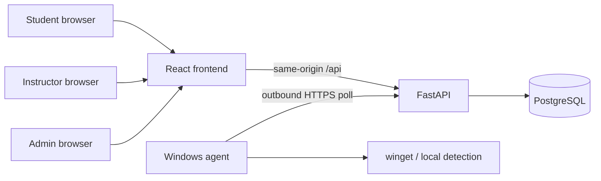

# Architecture

## Components

The cloud never pushes shell commands to the student machine. The agent polls for work, reports detection, waits for plan approval, then runs a fixed winget argv that it rebuilds from the local trusted catalog after matching package id and version.

## Roles

| Role | How created | Capabilities |
|---|---|---|
| Student | Public registration | Pair one device, start jobs, approve plans, view readiness |
| Instructor | Public registration with `role=instructor`, then admin approval | Own courses, enroll students, publish environment revisions |
| Administrator | `scripts/create_admin.py` only | Approve instructors, suspend users, view audit and health |

## Data model (core)

- `courses` owned by an instructor; `class_code` is a section label on the course.
- `environments` belong to a course; `environment_revisions` are versioned.
- Published revisions are immutable (PostgreSQL triggers).
- `installation_jobs` reference a specific revision. Readiness is computed from verification results for the current published revision.
- `agent_devices` are paired with hashed one-time codes. One active device per student.

## Trust boundaries

1. JWT access tokens are short-lived and kept in memory in the browser.
2. Refresh tokens are httpOnly cookies on `/api/v1/auth` with CSRF double-submit.
3. Role is reloaded from the database on each request, not trusted from the JWT alone.
4. Device tokens are opaque bearer credentials, distinct from JWTs.
5. Install commands never accept URL, hash, or shell text from the server.
