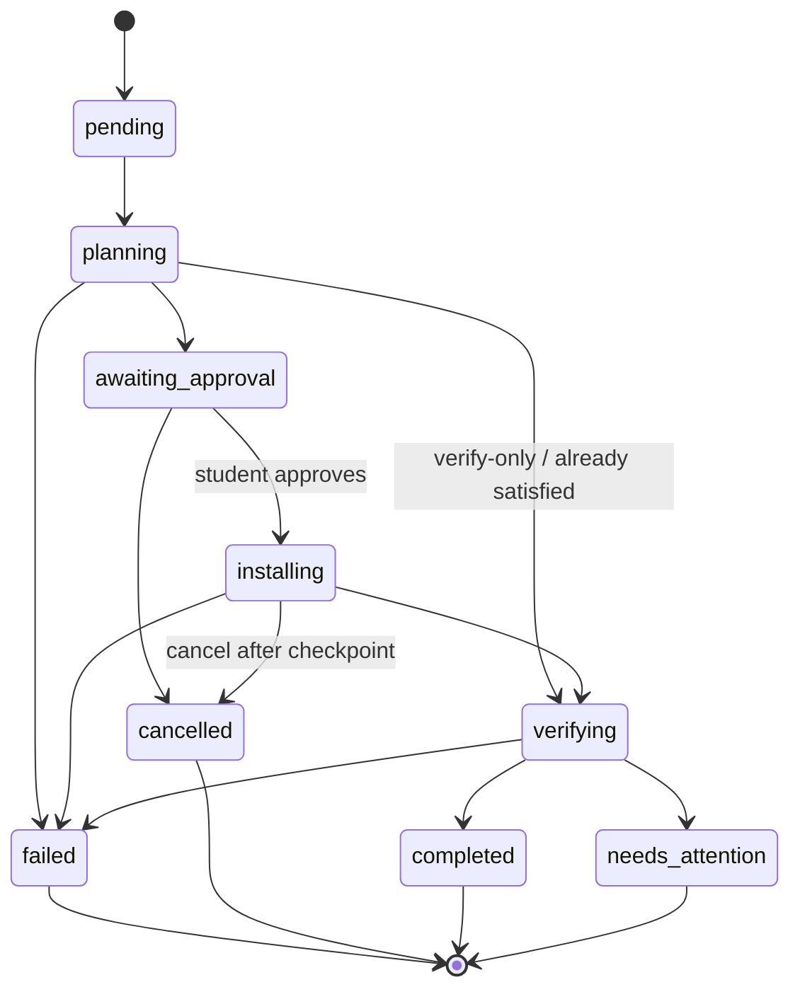

# Environment revisions and job lifecycle

## Revisions

1. Instructor creates an environment with a draft revision and software requirements.
2. Publishing a draft makes it immutable and sets `current_published_revision_id`.
3. Students are evaluated against the current published revision only.
4. Publishing a newer revision marks previously ready students as `needs_update` and notifies them.
5. Creating a new revision starts another draft; older published revisions remain in history.

Version constraints are numeric tuples. Exact pins must exist in `catalog/tools.json`. Ranges may be satisfied by an already-installed version even when that exact build is not installable from the catalog.

## Job states

- The agent cannot mark a job `completed`. The server computes verification against the revision.
- Cancel before install is immediate. Cancel during install waits for a safe checkpoint.
- Retry creates a new job, capped at three attempts. One active job per student/device/revision/operation.
- Duplicate active jobs are rejected.

## Readiness

An environment is `ready` only when every mandatory requirement passes verification on the current published revision. Optional failures are visible and do not block readiness.
